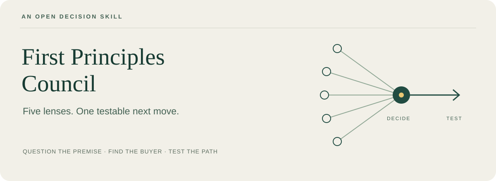

<p align="center"></p>

<p align="center"><strong>Find the assumption behind your business idea.<br>Decide what to try before you invest more.</strong></p>

<p align="center"><a href="README.zh-CN.md">简体中文</a> · <a href="https://github.com/CharlexH/first-principles-council/releases/tag/v1.3.0">Download</a> · <a href="docs/evaluation.md">See the comparisons</a> · <a href="LICENSE">MIT</a></p>

An experimental, portable agent skill for business opportunities, income paths, and consequential decisions. It asks the agent to expose hidden assumptions, reconsider who buys what and why, and recommend a small test that can change your next move.

**Feynman's rigor. Christensen's customer lens. A practical next step.**

## Five lenses, one answer

| Lens | The useful question | Method inspiration |
|---|---|---|
| Mechanism | Even if this solution worked perfectly, what could still block the outcome? | Richard Feynman |
| Switching | What makes this particular customer change what they do today? | Clayton Christensen |
| Boundaries | Could a different buyer, occasion, or scope make this opportunity viable? | W. Chan Kim & Renée Mauborgne |
| Behavior | What did people actually do, beyond saying they liked it? | Rob Fitzpatrick |
| Experiment | What observation would make us choose a different route? | Teresa Torres |

One agent uses the relevant lenses and gives an integrated recommendation. These are methodological inspirations, not simulated people, endorsements, or a claim that all five methods are historically “first principles.” Read the [sources and boundaries](skills/first-principles-thinking/references/method-notes.md).

## Try it on a real decision

After loading the skill, paste a question like this:

```text
Use $first-principles-thinking to help me choose a business opportunity.

I edit short videos for three paying local clients. Several have asked
about AI content, but nobody has bought that service yet. I have 8 hours
a week and $300 to test a new offer. Should I sell an AI subscription,
offer a fixed-scope service, or grow my existing work?

Identify the assumption that matters most, compare realistic alternatives,
and recommend one next test. Tell me what would change your recommendation.
```

This is an illustrative prompt, not a reported customer result. Add actual conversations, purchases, alternatives, available time and constraints. The agent should give you a **recommendation, its decisive assumption, one useful test, and a change-of-mind condition**. It should preserve an existing paid business when that is the better choice.

It also works as a method for product, work, and life questions; personal values should not be reduced to income.

## Install without dependencies

1. Download the [offline ZIP](https://github.com/CharlexH/first-principles-council/releases/download/v1.3.0/first-principles-council-v1.3.0-offline.zip), or receive it directly from a friend.
2. Extract it and read `START-HERE.txt`. Put the complete `first-principles-thinking` folder in the skill directory supported by your agent. Preserve an existing version before replacing it.
3. Reload skills as your host requires, then explicitly invoke `first-principles-thinking`. Hosts that support `$skill-name` can use the prompt above. Confirm that the host actually loads the skill, not just recognizes its name.

You can also give a file-capable agent the extracted folder and ask it to install it using its documented skill mechanism. The repository copy lives in [`skills/first-principles-thinking`](skills/first-principles-thinking).

**No native skills support?** Copy the included `PASTE-INTO-AGENT.txt` into a new conversation, then add your question. This is conversation-level instruction, not a persistent installation.

The package needs no Python, npm, API key, or extra downloads. Once you have the ZIP, installation does not require GitHub access. Your agent or model service must still be available; the package does not make a cloud model run offline. Host-specific discovery and behavior vary, and universal compatibility has not been established.

## What evidence do we have?

We compared eight related skills on the same development case, then froze this version before testing it against no-skill answers on two unseen cases. [Read the protocol, outputs, and findings](docs/evaluation.md), including ties and limitations. The [upstream review](docs/source-review.md) explains what we kept and rejected.

**Held-out result: one mixed result, one tie.** The skill gave a more diagnostic channel test in one case; the baseline also found an income route it missed.

**There is no established general advantage over a capable agent without this skill.** Its concrete offering is a reusable decision method, inspectable instructions, offline portability, and public comparison evidence. More framework names, longer answers, and famous names do not prove better judgment. No real customer demand or income has been validated by these synthetic tests.

## Improve it with evidence

Bring a redacted case where the recommendation changed an action—or where the skill made the answer worse. Include the no-skill answer when possible. See [CONTRIBUTING.md](CONTRIBUTING.md) for a small, fair comparison protocol.

[MIT license](LICENSE) for this project's original material. [Third-party notices](THIRD_PARTY_NOTICES.md) identify reviewed sources. No affiliation with or endorsement by the people or projects referenced.
