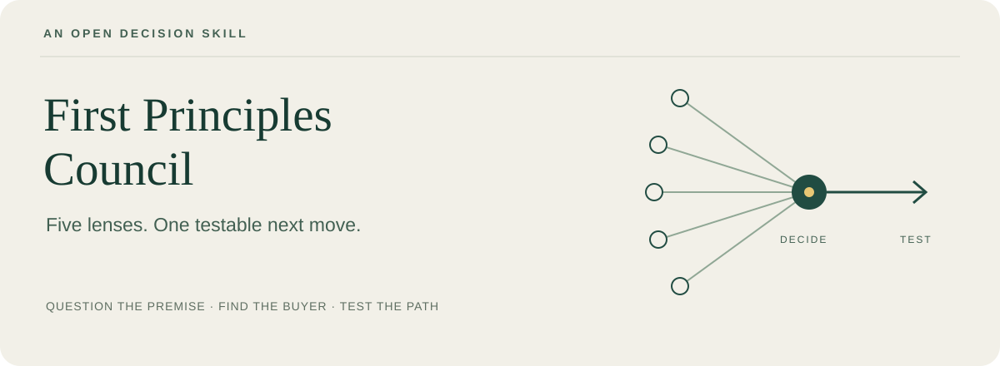

<p align="center"></p>

<p align="center"><strong>第一性原理议事厅<br>看清生意背后的假设，再决定下一步怎么试。</strong></p>

<p align="center"><a href="README.md">English</a> · <a href="https://github.com/CharlexH/first-principles-council/releases/tag/v1.3.0">下载安装包</a> · <a href="docs/evaluation.md">看实际对照</a> · <a href="LICENSE">MIT 开源</a></p>

一个实验性的通用 agent skill，主要帮助你发现商业机会、判断赚钱路径，也适用于产品、工作与生活中的重要选择。

**借鉴费曼的求真、克里斯坦森的客户视角，把一个生意想法变成可验证的下一步。**

## 五种方法，形成一个判断

| 视角 | 帮你追问什么 | 方法启发 |
|---|---|---|
| 机制 | 就算方案免费又完美，什么仍会阻止目标实现？ | 理查德·费曼 |
| 切换 | 这个客户为什么会在此刻改变原来的做法？ | 克莱顿·克里斯坦森 |
| 边界 | 换一个购买者、购买时机或交付范围，机会会不会不同？ | W. 钱·金、勒妮·莫博涅 |
| 行为 | 除了说喜欢，对方实际上做过什么？ | 罗布·菲茨帕特里克 |
| 验证 | 看到什么结果，我们就应该改选另一条路？ | 特蕾莎·托雷斯 |

一个 agent 按问题选用这些方法，给出整合后的建议。名字表示方法来源，不代表名人本人参与、模拟人格或官方背书；这几种方法也不是同一个历史理论。详见[出处与边界](skills/first-principles-thinking/references/method-notes.md)。

## 可以这样问

加载后，把真实情况直接告诉它：

```text
用 $first-principles-thinking 帮我判断这门生意。

我现在给三家本地商户剪短视频，已经有稳定付费。
最近几位客户问过 AI 内容，但还没人为这个单独付钱。
我每周能拿出 8 小时，最多花 2000 元尝试。
应该卖 AI 月费套餐、做一次性交付，还是继续扩大原有业务？

帮我找出最关键的隐藏假设，比较几条现实可行的路，
选一个下一步验证，并说清什么结果会让你改判。
```

这是使用示例，不是真实客户成绩。尽量补充已发生的购买、沟通、替代方案、时间和限制。预期得到的是：**明确倾向、决定性假设、一个优先验证、改判条件**。如果继续原有生意更好，它应当直接说出来。

用于生活选择时，应保留你的价值排序，不把所有事情都换算成收入。

## 微信收到压缩包，也能直接装

1. 下载[离线安装包](https://github.com/CharlexH/first-principles-council/releases/download/v1.3.0/first-principles-council-v1.3.0-offline.zip)，或直接接收朋友发来的 ZIP。
2. 解压，打开 `START-HERE.txt`。将完整的 `first-principles-thinking` 文件夹放入所用 agent 支持的技能目录；已有旧版时先保留备份。
3. 按宿主要求重新加载技能，再明确调用 `first-principles-thinking`。支持 `$技能名` 的宿主可直接用上面的提问。确认它确实读取了技能，而不只是复述名字。

也可以把解压后的文件夹交给有本地文件访问能力的 agent，让它按自己的技能机制安装并核实。仓库中的技能在 [`skills/first-principles-thinking`](skills/first-principles-thinking)。

如果只是普通聊天工具，复制 `PASTE-INTO-AGENT.txt` 全文到新对话，再发问题即可。这只在当前对话提供指令，不等于永久安装。

安装包不需要 Python、npm、API key 或额外下载。拿到 ZIP 后，安装不依赖 GitHub；但你使用的 agent／模型服务仍需可用，它不会让云端模型变成本地离线模型。不同宿主的识别机制不同，目前不承诺所有 agent 都已验证兼容。

## 它比不用 skill 好在哪里？

我们让八个相关技能回答同一道开发题，再冻结新版，用两道未见过的经营案例与无技能回答对照。[完整记录](docs/evaluation.md)会保留答卷、平局和局限；[逐个审阅记录](docs/source-review.md)说明具体吸收了什么、舍弃了什么。

**未见题结果：一道各有优劣，一道平局。** 新版有一处渠道验证更清楚，普通 agent 也找到了一条新版遗漏的收入路线。

**目前没有足够证据证明它普遍优于一个能力强的普通 agent。** 可以明确提供的是：一套可复用的判断方法、可检查的指令、离线分发方式，以及公开的效果对照。框架更多、文字更长、名人更多，都不算效果证据。合成案例也没有验证真实需求或赚钱结果。

## 一起改进

欢迎提交脱敏案例，尤其是“它改变了哪个实际行动”或“用了反而更差”。有无技能的原始回答都保留，按 [CONTRIBUTING.md](CONTRIBUTING.md) 做小规模、公平的对照。

本项目原创内容采用 [MIT 协议](LICENSE)。参考项目见[第三方说明](THIRD_PARTY_NOTICES.md)。与所提及的人物和项目无隶属或背书关系。
